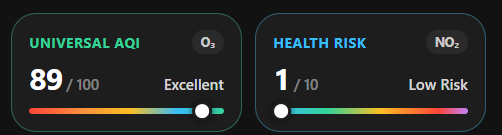

# Air Quality & Health Card (`custom:air-quality-card`)

A minimalist, side-by-side custom Lovelace card for Home Assistant displaying **Universal AQI (`0–100`)** and **Canada Health Risk Index — AQHI (`1–10+`)** with spectrum progress bars and dominant pollutant badges.



## Features

- **Minimalist 2-Column Layout**: Compact side-by-side tiles for **Universal AQI** and **Health Risk (AQHI)**.
- **Spectrum Progress Bars**: Slim `5px` multi-stop gradient bars with live position indicator dots.
- **Dynamic Status Coloring**: Automatically tints borders and labels based on current air quality and health risk thresholds.
- **Formatted Pollutant Badges**: Converts raw pollutant codes (`o3`, `no2`, `pm25`, `pm10`, `co`, `so2`) into subscripted chemical symbols (`O₃`, `NO₂`, `PM₂.₅`, `PM₁₀`, `CO`, `SO₂`).
- **Native History Integration**: Clicking either tile opens Home Assistant's native `hass-more-info` history dialog for that sensor.

## Installation

### HACS (Custom Repository)

1. Open **HACS** in Home Assistant → **Frontend** → top-right menu (`⋮`) → **Custom repositories**.
2. Add this repository URL with category **Dashboard** (Lovelace).
3. Install **Air Quality & Health Card** and reload your browser.

### Manual Installation

1. Copy `air-quality-card.js` to your Home Assistant `config/www/` folder.
2. Add `/local/air-quality-card.js` as a **JavaScript Module** under **Settings → Dashboards → Resources**.

## Configuration

```yaml
type: custom:air-quality-card
uaqi_entity: sensor.home_universal_air_quality_index
uaqi_category_entity: sensor.home_uaqi_category
uaqi_pollutant_entity: sensor.home_uaqi_dominant_pollutant
aqhi_entity: sensor.home_aqhi_ca_aqi
aqhi_category_entity: sensor.home_aqhi_ca_category
aqhi_pollutant_entity: sensor.home_aqhi_ca_dominant_pollutant
```

### Options

| Name | Type | Default | Description |
| :--- | :--- | :--- | :--- |
| `type` | `string` | **Required** | `custom:air-quality-card` |
| `uaqi_entity` | `string` | `sensor.home_universal_air_quality_index` | Universal AQI score sensor (`0–100`) |
| `uaqi_category_entity` | `string` | `sensor.home_uaqi_category` | Universal AQI category sensor |
| `uaqi_pollutant_entity` | `string` | `sensor.home_uaqi_dominant_pollutant` | Universal AQI dominant pollutant sensor |
| `aqhi_entity` | `string` | `sensor.home_aqhi_ca_aqi` | Canada AQHI score sensor (`1–10+`) |
| `aqhi_category_entity` | `string` | `sensor.home_aqhi_ca_category` | Canada AQHI category sensor |
| `aqhi_pollutant_entity` | `string` | `sensor.home_aqhi_ca_dominant_pollutant` | Canada AQHI dominant pollutant sensor |
